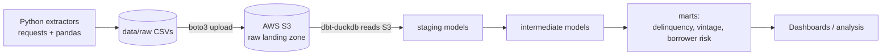

# Fintech Consumer Credit & Loan Pipeline

An end-to-end ELT pipeline that extracts consumer credit and loan payment records with Python, lands them in an **AWS S3** raw zone, and transforms them with **dbt Core** into tested models for **credit risk, 30/60/90-day delinquency rates, and loan performance**.

> Status: 🚧 In progress

## Architecture



## Tech stack

| Layer | Tools |
|---|---|
| Extract | Python, `requests`, `pandas`, `numpy` |
| Load | AWS S3, `boto3` |
| Transform & test | dbt Core, DuckDB (`dbt-duckdb`), SQL |
| Version control | Git, GitHub |
| Dev environment | VS Code, AI coding assistants (Claude Code / Cursor) |

## Project structure

```
consumer-credit-pipeline/
├── extract/
│   ├── generate_loans.py      # synthetic borrowers, loans, monthly installments
│   └── extract_hmda.py        # real public loan data from the CFPB HMDA API
├── load/
│   └── upload_to_s3.py        # boto3 upload to s3://<bucket>/raw/
├── dbt/
│   ├── models/
│   │   ├── staging/           # type casting, cleaning, credit bands
│   │   ├── intermediate/      # days late per installment, loan-level DPD
│   │   └── marts/             # fct_loan_performance, mart_delinquency_rates,
│   │                          # mart_vintage_performance, dim_borrower_risk
│   ├── tests/                 # custom data-quality tests
│   └── macros/                # as-of date, delinquency bucket logic
├── requirements.txt
└── .env.example
```

## Data

Real consumer loan payment histories are private, so `generate_loans.py` creates a realistic synthetic dataset (~5k borrowers, ~8k loans, ~190k installments) where lower credit scores miss more payments and delinquent loans tend to roll into deeper delinquency. `extract_hmda.py` pulls real, public mortgage origination data from the CFPB for comparison and enrichment.

## Key metrics

- **Days past due (DPD):** days since the oldest unpaid installment was due, as of the reporting date
- **30/60/90+ delinquency rate:** share of open loans (and of open balance) at 30+, 60+, 90+ DPD
- **Ever-30+ rate by vintage:** share of each origination quarter that has ever been 30+ days late
- **Charge-off rate:** loans 180+ DPD
- **Borrower risk tier:** rule-based on credit score, DTI, and current delinquency

## How to run

```bash
# 1. set up environment
python -m venv .venv
source .venv/bin/activate          # Windows: .venv\Scripts\activate
pip install -r requirements.txt

# 2. extract
python extract/generate_loans.py

# 3. load to S3 (after `aws configure` and setting S3_BUCKET in .env)
python load/upload_to_s3.py

# 4. transform + test
cd dbt
dbt debug                          # check the connection
dbt build                          # run all models and tests (reads local CSVs)

# or read straight from S3:
# RAW_DATA_PATH=s3://<your-bucket>/raw dbt build --target s3
```

## Roadmap

- [x] Synthetic data generator and HMDA API extractor
- [x] S3 raw landing zone with boto3
- [x] dbt staging → intermediate → marts with schema and custom tests
- [ ] Dashboard on top of the marts
- [ ] Orchestration (GitHub Actions on a schedule)
- [ ] Incremental models for payments
